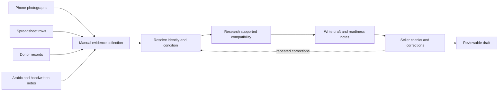
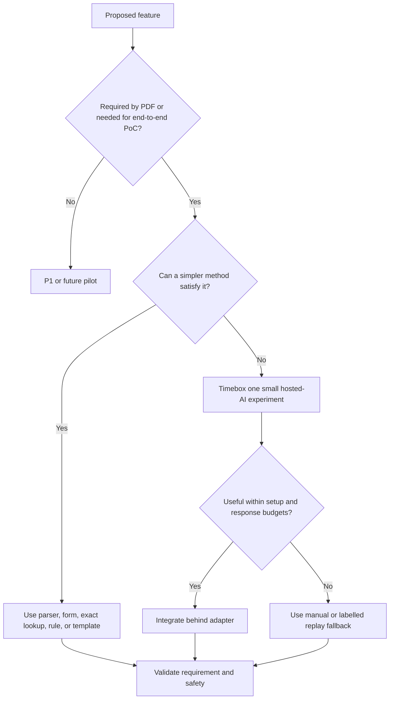
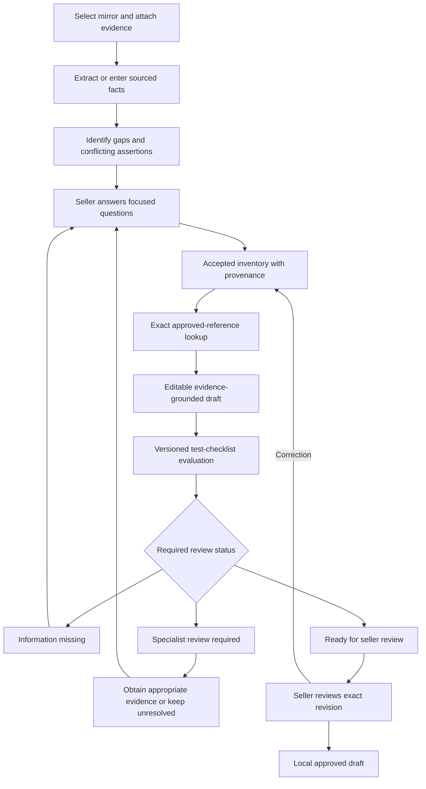

# BRD — Business Requirements Document

## eBay salvage-parts listing assistant: hackathon proof of concept

| Item | Decision |
|---|---|
| Version/date | 1.2 — 27 October 2026 |
| Status | Working offline PoC; business benefits unmeasured; no organizer/pilot sign-off |
| Primary authority | `eBay_Case Study_ From Salvage Yard to Global Marketplace.pdf`, all four pages |
| Detailed research | [Requirements and research brief](EBAY_HACKATHON_REQUIREMENTS_AND_RESEARCH.md) |
| Product specification | [PRD](PRD.md) |
| Technical specification | [TRD](TRD.md) |
| Build envelope | Three-day prototype; ten demo parts; one family; one test corridor |
| Selected family/corridor | Side-view mirrors; UAE-to-UK — team choices based on PDF examples |
| Core principle | Faster evidence-grounded preparation, not autonomous selling or invented completeness |

> **Current implementation baseline (offline update):** No external API calls at runtime. The application uses React/Vite in `frontend/`, Express in `backend/`, SQLite, bundled English/Arabic OCR and a local pretrained damage-segmentation CNN executed through CPU ONNX Runtime. Prior hosted-AI/JSON-store passages below are historical proposals superseded by this update. CSV is supported; XLSX remains optional. One Docker app persists database/uploads/results.

### Visual inspection extension and business boundary

- The supplied links now contribute actual assets: 12 mirror crops from the archive referenced by Brachingo's master-branch configuration, and four vehicle benchmark photos plus a pretrained damage checkpoint from `cloudwhynot/car-damage-detection-yolo`.
- These are source-attributed reference photos, not verified Noor inventory. Mirror reference records have unknown donor, condition, testing and identifiers; whole-vehicle benchmarks remain separate from the ten-mirror listing scope.
- Local inference shows predicted masks and a score-weighted segmentation activation heatmap, not Grad-CAM, defect severity or electrical-function evidence.
- Positive stock predictions require per-region seller confirmation/rejection and block approval while unresolved. Only explicit confirmation becomes a seller-reported condition assertion.
- The general model is not validated for detached mirrors or broken mounting tabs. No detection is not a damage-free claim. This preserves the evidence-focused 25% criterion rather than displaying misleading visual certainty.
- Dataset CC BY badge, repository MIT notice and Ultralytics derivative-model terms are recorded separately. Underlying image/training-data rights are not independently certified; public/commercial release requires license review.
- No new model training, GPU or Python service is required by the running app; Python was used only for one-time export and crop preparation.

### Target audience and business relationship

- **Primary product audience: B2B seller enablement.** Automotive salvage businesses, dismantlers, used-parts inventory staff and listing operators use this assistant. Noor is the fictional example.
- **Explicit downstream B2B buyers:** Garages and parts traders, as stated on PDF page 1.
- **Potential downstream B2C buyers (inferred, not explicitly specified):** Individual vehicle owners and DIY buyers who may buy eventual listings. They are not application users in the PoC.
- The PoC is a seller tool, not a new B2B/B2C marketplace; no buyer portal, checkout, payments or live listings are built.
- No subscription/pricing model or consumer-demand claim is assumed.

### Rubric-led delivery

- 30% business value: actual manual/assisted measurement capture.
- 25% AI/evidence: local OCR and actual CNN masks/activation overlays, source-linked assertions, provisional region review, explicit conflicts and abstention.
- 20% working prototype: complete normal and PDF difficult journeys with persisted state.
- 15% seller experience: bilingual labels/questions, focused actions and correct-once propagation.
- 10% responsible design: offline data handling, seller approval, honest synthetic references and Docker persistence.
- These are implementation priorities, not claims of achieved judge scores.

> **Diagrams:** All three documents use Mermaid for editable flowcharts, state diagrams, and sequence diagrams. View them in a Mermaid-enabled Markdown preview. If your editor does not render Mermaid, the diagram source remains in the files; it can be opened in a Mermaid-compatible viewer. Diagram rendering has not been tested in your editor.

## 1. Executive summary

Noor’s fictional Dubai salvage business has 120 used parts, but the hackathon should demonstrate preparation of only ten parts in one product family. Her team knows the inventory; the bottleneck is turning photographs, spreadsheet entries, donor records, and Arabic notes into accurate international listing drafts.

The proposed PoC organizes evidence, exposes gaps and conflicts, asks targeted questions, produces editable drafts, and evaluates a dated test-readiness checklist. It deliberately does not certify authenticity, guarantee fitment, infer electrical function from images, publish listings, or book shipments.

**Business outcome:** Reduce the effort to reach a trustworthy seller-reviewed draft, without replacing uncertainty with guesses.

**Delivery strategy:** Use a working local workflow with transactional SQLite, source-linked assertions, exact synthetic-reference matching, deterministic rules/templates and bundled CPU OCR. No hosted model, external runtime API, GPU, custom training or vector database is required.

## 2. Business problem and current state

### 2.1 Current operating situation — PDF page 1

- Used automotive parts are recovered from dismantled vehicles.
- Broader inventory includes headlights, taillights, mirrors, door handles, and interior trim.
- Sales currently occur through yard visits, calls, and WhatsApp enquiries to garages/traders.
- Photos are on employees’ phones.
- Spreadsheet records include short descriptions, asking prices, and storage locations.
- Donor records are inconsistent; identifiers can be missing/unreadable.
- Cosmetic damage and testing status may be undocumented.
- Some information is available only in Arabic.
- Seller and scenarios are fictional; no customer results should be claimed.

### 2.2 Current-state flow

### 2.3 Business pain points

- Repeated transcription and translation.
- Unclear source-to-part association.
- Conflicting facts hidden by a polished description.
- Accidental overstatement of fitment or functionality.
- Defects lost when drafts are edited or regenerated.
- A correction repeated across multiple outputs.
- Lack of a clear prioritized next-action list.

## 3. Objectives and business outcomes

| Objective | Desired PoC evidence | Not a permitted claim |
|---|---|---|
| O01 — Faster preparation | Manual-versus-assisted preparation and correction time | Guaranteed commercial time saving before measurement |
| O02 — Accurate inventory | Supported populated attributes checked against an independent key | More fields always means better accuracy |
| O03 — Better issue detection | Missing/conflict detection precision and recall | AI can resolve all ambiguity without inspection |
| O04 — Complete disclosure | Known defects and testing limitations remain visible | No defect detected means fully functional |
| O05 — Practical seller experience | English/Arabic questions and correct-once behavior | Autonomous approval or guaranteed seller adoption |
| O06 — Reproducibility | Normal and difficult journeys work without production access | A recorded/replayed response is live AI |

- Targets will be set after the initial baseline; no invented percentage uplift is included.
- The hackathon demonstrates feasibility, not statistically established conversion, return-rate, or revenue improvement.

## 4. Stakeholders and responsibilities

| Stakeholder | Need/responsibility |
|---|---|
| Noor / seller | Correct inventory, answer questions, inspect drafts, approve exact revision |
| Yard employee | Provide photos, identifiers, physical observations, packaging measurements, and test evidence |
| Hackathon team | Build, validate, disclose limits, preserve evidence, measure actual performance |
| Domain/Arabic reviewer | Review synthetic labels, technical wording, translations, and unresolved cases where available |
| Judges | Reproduce workflow and assess business, evidence, usability, and prototype quality |
| Organizers — eBay/DCC | Confirm dataset, reference checklist, mentor availability, and submission format as described in PDF p.4 |
| Future buyer | Receives clear used-condition and supported compatibility information; no buyer portal is built |

- Seller registration is assumed complete.
- DCC is not expanded because the PDF does not define the acronym.
- Single-seller demo use does not require a role-management or authentication platform.

## 5. Scope and priorities

### 5.1 P0 — the committed working PoC

- Ten demo mirrors; one labelled test corridor.
- Twenty fictional development/evaluation records if the shared pack is unavailable; ten are the demo batch.
- JPEG/PNG photo upload and manual source-to-stock association.
- CSV spreadsheet import; direct XLSX import is not required for the first release.
- Typed English/Arabic notes and note/label photographs.
- Structured fields, source references, missing/conflicting-detail detection.
- Targeted questions on identifiers, side, damage, testing, included components, packaged size, and weight.
- English and Arabic interface/question labels; original source text retained.
- Exact lookup against a small approved or unmistakably synthetic compatibility table.
- Editable title, description, category suggestion, and relevant item specifics with protected disclosures and conservative claim checks.
- Dated/versioned test-readiness checklist and the three required statuses.
- Correct-once propagation to inventory, draft, and checklist.
- Explicit seller approval bound to current content revision.
- Labelled replay mode, actual measurements, setup instructions, and five-minute demo.

### 5.2 P1 — only after P0 acceptance

- Direct XLSX import.
- Image-region highlighting instead of source-level image links.
- AI-written prose beyond deterministic templates.
- CSV/JSON draft export and attractive revision diffs.
- More detailed dashboard analytics.
- Voice input or additional languages.

### 5.3 Out of scope

- Live eBay publication, order handling, checkout, or production system integration.
- Seller registration or production credentials.
- Shipment booking or comprehensive customs/regulatory assessment.
- Airbags, batteries, hazardous parts, and other safety-critical components.
- Authenticity certification, guaranteed vehicle compatibility, or photo-derived functionality.
- Full WhatsApp integration, pricing optimization, or a universal marketplace.
- Custom model training, local heavy VLM serving, embeddings/vector databases, multi-agent systems, and distributed infrastructure.

### 5.4 Scope-selection flow

## 6. Business requirements

| ID | Business requirement | Priority | Product mapping |
|---|---|---|---|
| B01 | Consolidate fragmented evidence without losing source attribution | P0 | F01–F02 |
| B02 | Make missing and conflicting information visible | P0 | F03, F05 |
| B03 | Support English and Arabic seller interactions | P0 | F04 |
| B04 | Support only evidence-backed compatibility claims | P0 | F06 |
| B05 | Produce editable drafts with clear used-condition, defect, and testing disclosure | P0 | F07–F08 |
| B06 | Guide next actions using supplied/approved, dated test material | P0 | F09 |
| B07 | Propagate corrections without stale contradictions | P0 | F10 |
| B08 | Keep seller approval and trust boundaries explicit | P0 | F11, F13 |
| B09 | Run without production systems or customer-identifiable data | P0 | F12–F13 |
| B10 | Demonstrate measurable benefit against manual preparation | P0 | F14 |
| B11 | Reproduce normal and difficult cases within submission constraints | P0 | F12, F15 |
| B12 | Finish a useful PoC inside three days without heavy infrastructure | P0 | F01–F15; TRD decisions |

## 7. Future-state business process

- “Local approved draft” does not mean a published listing or shipping clearance.
- An exact reference match is a narrowly supported candidate, not a guarantee.
- A missing identifier or an untested part is a blocker only where the applicable test rule requires it.

## 8. Trust and operating rules

- **BR01:** Preserve competing source assertions until an explicit recorded resolution.
- **BR02:** Donor year never becomes compatibility year automatically.
- **BR03:** An unreadable identifier remains unreadable; do not complete it from plausibility.
- **BR04:** “Testing not recorded,” “explicitly untested,” “partial test,” “passed,” and “failed” remain distinct.
- **BR05:** Visible possible damage remains an observation until confirmed; do not suppress it.
- **BR06:** Seller confirmation is an attributable assertion, not independent certification.
- **BR07:** A confirmed defect cannot disappear during editing/regeneration.
- **BR08:** “Ready for seller review” is separate from seller approval.
- **BR09:** Material edits invalidate prior approval.
- **BR10:** All source-dependent guidance shows date/version and test status.
- **BR11:** Unapproved/missing reference material remains provisional, not authoritative.
- **BR12:** Excluded components never enter the normal draft flow.
- **BR13:** Replay, manual, and live extraction are distinguished in the UI and metrics.
- **BR14:** AI failure must not erase data or fabricate an answer.

## 9. Assumptions, dependencies, and risks

### 9.1 Assumptions

- Three-day build envelope is inherited from the PDF; actual team size/hours are unknown.
- One seller and one locally running application process are sufficient for judging.
- CSV exported from a spreadsheet satisfies the spreadsheet-input journey; XLSX remains optional unless organizers explicitly require it.
- Hosted AI uses development credentials only, if available and allowed.
- The shared pack, actual checklist, and approved compatibility dataset are not attached.
- A replay-only release demonstrates software behavior but not live model accuracy; this must be disclosed.

### 9.2 Risks and mitigation

| Risk | Impact | Mitigation / stop rule |
|---|---|---|
| Heavy model setup | Core journey unfinished | No local VLM/training; cap hosted-model spike at two elapsed hours |
| Missing organizer pack | Unverifiable rules or fitment | Label fixtures/checklist synthetic; request approval; do not claim official readiness |
| Network/API outage | Demo interrupted | Explicit replay mode; manual source entry; no silent substitution |
| Arabic/identifier extraction errors | Wrong facts/claims | Preserve original, require critical confirmation, use reviewed fixtures |
| Cosmetic polish displaces correctness | Weak evidence score | Working vertical slice before decoration; reserve final day for measurement |
| Free-form edited claims bypass checks | Unsupported description | Conservative hold on unvalidated edits; protected disclosures; document semantic limits |
| New source contradicts approved draft | Stale approval | One versioned state and automatic approval invalidation |
| Public dataset misuse | Permission problem or domain mismatch | Prefer owned/approved photos; audit per-file/model/data terms |
| Local file persistence deployed serverlessly | Lost/inconsistent data | Local single-process deployment only; database migration is future work |
| Excessive clarification | No time savings | Ask applicable high-impact questions first; allow “I do not know” |

## 10. Success measurement and judging alignment

### 10.1 Mandatory comparison

- Use the same inventory and evidence for manual and assisted workflows.
- Include clarification, review, and factual-correction time.
- Measure preparation time, populated-attribute accuracy, missing/conflict detection, disclosure completeness, and corrections before approval.
- Score accepted unknowns correctly; do not reward invented completeness.
- Keep held-out truth data outside the application/model inputs.
- Report actual sample size, extraction mode, and failures.

### 10.2 Business release gates — proposed, not organizer thresholds

- Normal and PDF mirror-conflict paths run end to end.
- Confirmed defects/testing limits survive editing and regeneration.
- No tested guaranteed-fitment, certified-authenticity, or photo-derived-function statement.
- All critical corrections propagate across outputs.
- Seller approval is revision-bound and never automatic.
- No production access or identifiable customers are required.
- Replay/manual limitations and provisional references are visible.

| Judging criterion | Weight | Required proof |
|---|---:|---|
| Business relevance/value | 30% | Actual preparation/correction comparison |
| AI quality/evidence | 25% | Valid sources, abstention, difficult case |
| Working prototype | 20% | Complete and reproducible journey |
| Seller experience | 15% | English/Arabic, clear questions, correction propagation |
| Responsible design/scalability | 10% | Safe data, approval, cost, realistic pilot limits |

## 11. Delivery milestones and change control

| Milestone | Deadline target | Acceptance |
|---|---|---|
| M1 — Evidence vertical slice | End of Day 1 | Import, source display, conflicts, and seller correction work |
| M2 — Complete review journey | End of Day 2 | Draft, exact reference lookup, checklist, propagation, approval work |
| M3 — Evaluated submission | Day 3 | Baseline/results, difficult case, reproduction, five-minute demo |

- Working replay/manual flow comes before hosted AI experimentation.
- If the hosted spike exceeds two hours, stop it and complete the P0 workflow.
- Freeze feature scope before final evaluation; admit only critical defect fixes.
- Any change expanding family/corridor, introducing production access, or weakening disclosures is rejected for the PoC.
- XLSX, free-form AI prose, and extra analytics are first to cut.

## 12. Submission and pilot boundary

### Required submission

- Working prototype, source code, setup instructions.
- Five-minute demonstration with one normal and one difficult case.
- Short note: problem, data, approach, actual tests, limitations, and pilot requirements.
- Explicit replay/manual/live modes and source provenance.

### A real pilot would additionally need

- Seller consent and approved operational data.
- Licensed maintained fitment references and official current category/checklist material.
- Stronger privacy/authentication/retention controls.
- Persistent database and multi-user concurrency design.
- Broader evaluation of Arabic, identifiers, source associations, and draft edits.
- Authorized platform integration and operating budget where needed.

**Approval requested for build baseline:** Keep the P0 scope fixed and use [PRD](PRD.md) for behavior and [TRD](TRD.md) for contracts. This document is a proposed team plan; no stakeholder approval has been recorded.
