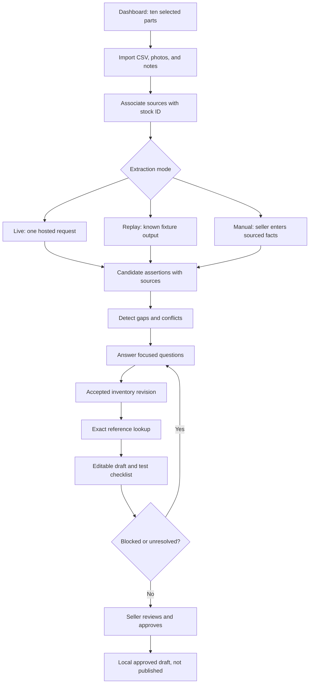
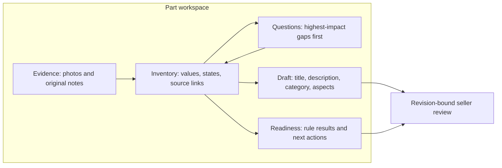
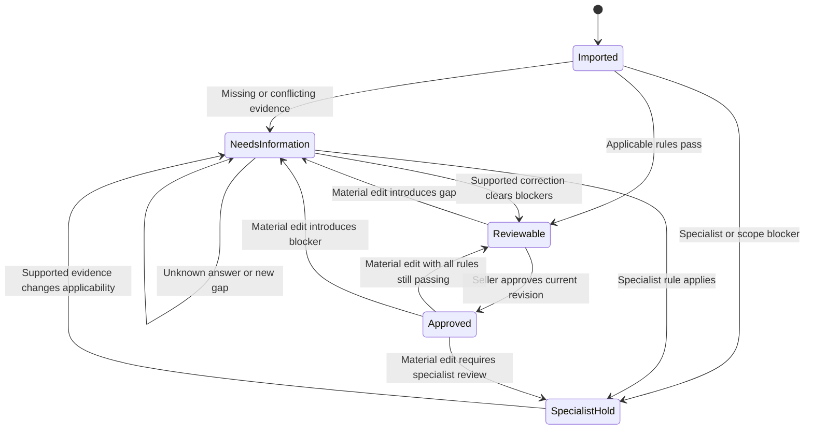

# PRD — Product Requirements Document

## eBay salvage-parts listing assistant: implementation-ready PoC behavior

| Item | Baseline |
|---|---|
| Version/date | 1.2 — 27 October 2026 |
| Status | Core offline seller journey implemented and browser-tested; PoC limits documented |
| Business contract | [BRD](BRD.md) |
| Engineering contract | [TRD](TRD.md) |
| Source | Four-page eBay case-study PDF; [complete research](EBAY_HACKATHON_REQUIREMENTS_AND_RESEARCH.md) |
| Product family / corridor | Side-view mirrors / UAE-to-UK, selected from PDF examples |
| Demo / input pack | Ten demo parts / twenty fictional records where available |
| Languages | English and Arabic for seller interaction; English buyer-facing draft |
| Delivery rule | Working offline PoC first; local OCR and SQLite; no external runtime API or heavy model setup |

> **Offline implementation update:** Runtime inference is `local_ocr` and `local_onnx`, with manual sourced correction; no hosted model/API, runtime download or fake live output. React/Vite, Express and SQLite implement the workflow. Earlier hosted/replay clauses are historical proposals superseded by this update. Seed records remain visibly fictional. OCR uses a 30-second timeout; visual inference has a 60-second response budget.

### F16 — Real-photo local visual inspection (implemented extension)

- Accessible via **Visual inspection** (`#vision`) and beside stock photo evidence.
- Catalog: 12 real mirror crops with original part-annotation masks, plus four real vehicle damage benchmarks from the supplied links. Metadata, attribution, crop geometry, source hashes and licensing caveats are available.
- Whole-vehicle benchmarks cannot become mirror listing records. Mirror crops can open separate reference-only records without invented donor/identifier/condition data.
- Run a local pretrained segmentation CNN; switch **Original**, **Damage masks**, **Heatmap** and adjust the threshold. Six actual classes: dent, scratch, crack, glass shatter, lamp broken and tire flat.
- Heatmap means segmentation activation weighted by detection score, not Grad-CAM, calibrated confidence or severity. Original dataset part masks are explicitly not damage predictions.
- Positive stock findings stay pending, appear as unconfirmed suggestions in disclosures, invalidate prior approval and block new approval until per-region seller confirmation/rejection.
- Confirmed regions add source-linked seller assertions and propagate to draft/readiness; rejected regions remain audited. No-detection results never establish clean condition, function, authenticity or fitment.
- Acceptance: real benchmark produces masks and heatmap; real small mirror crop yields correctly sized artifacts and cautious no-detection wording; source-linked review updates condition; stale revisions are rejected; browser makes no external requests.
- Limit: this is a general vehicle-damage model, not validated detached-mirror/mounting-tab detection. Public/commercial image/model release needs declared-license and derivative-rights review.

### Target audience and downstream buyers

- **Primary: B2B seller operators** in automotive salvage businesses: owners, yard staff, inventory and listing preparers.
- **Explicit downstream B2B:** Garages and traders buying parts; drafts should expose identifiers, contents, condition and testing limits.
- **Potential B2C (inferred):** Vehicle owners/DIY buyers benefit from plain condition/compatibility disclosures, but no consumer shopping flow is built.
- **Evaluators:** Judges/mentors are demo users, not the commercial customer segment.
- Interface priorities follow the 30/25/20/15/10 rubric: measured usefulness, evidence accuracy, working edge cases, bilingual usability and responsible operation.

## 1. Product objective

**Help a seller prepare accurate, editable used-mirror drafts from fragmented evidence, with useful uncertainty and clear next actions.**

- Save preparation effort without inventing identifiers, defects, testing results, or fitment.
- Make the PDF’s difficult mirror scenario a first-class demonstration.
- Preserve seller control and a practical three-day build scope.
- Keep one visible workflow instead of multiple chatbots, microservices, or complicated model choices.

## 2. Users and jobs to be done

| User | Job | Product response |
|---|---|---|
| Seller / Noor | Turn scattered records into ten reviewable drafts | Import, questions, draft/checklist workspace, approval |
| Yard employee | Add missing physical details | Simple identifier, side, damage, testing, components, and package fields |
| Judge | Reproduce and evaluate the PoC | Seeded sample, clear extraction mode, setup, metrics, normal/difficult case |
| Domain reviewer, if available | Assess unresolved or out-of-scope uncertainty | Evidence and prioritized escalation explanation; no role-management system required |

- One trusted local demo operator represents these interactions.
- Seller login, team permissions, and buyer-facing account flows are out of scope.

## 3. Scope and feature priority

### P0 — complete before adding extras

1. Source import/association and structured inventory.
2. Provenance, gaps/conflicts, English/Arabic clarification.
3. Exact approved/synthetic reference lookup.
4. Editable template-based drafts with conservative claim validation.
5. Versioned test-readiness results and prioritized actions.
6. Correct-once propagation and explicit revision-bound approval.
7. Replay/manual mode, scope/privacy controls, and measured reproduction.

### P1 — only after P0 release gates pass

- Direct XLSX import.
- Photo-region highlighting.
- Hosted-AI prose generation in place of templates.
- JSON/CSV draft export; read-only approval preview is sufficient for P0.
- Advanced visual diffs and cost analytics.
- Voice input or a third language.

### Explicit exclusions

- Live publishing/booking, production credentials/integrations, customs/clearance assessment.
- Hazardous/safety-critical parts, authenticity certification, guaranteed fitment.
- Local heavy VLMs, training, vector retrieval, multiple model providers, agent orchestration.

## 4. Seller journey and information architecture

### 4.1 Main process



### 4.2 Application screens

| Screen | Required elements | P0 action |
|---|---|---|
| Dashboard | Part ID, thumbnail, storage location, readiness, approval, extraction-mode badge | Open part / import batch |
| Import | CSV template/help, upload, row preview, source-to-part association, validation errors | Confirm valid import |
| Part workspace | Evidence panel, accepted fields, competing assertions, question queue | Confirm/correct facts |
| Draft/readiness tab | Editable title/description/category/aspects, donor vs compatibility, disclosures, rule results | Save validated edit / review |
| Review panel | Current content revision, unresolved items, seller acknowledgment, local approval preview | Approve exact current revision |

### 4.3 Workspace layout



- Desktop uses side-by-side evidence and work panels; smaller displays stack them.
- Status must use text as well as color.
- The mode and test-checklist disclaimer stay visible on every part screen.

## 5. Functional requirements

### F01 — Import and associate sources

- **Priority / business mapping:** P0 / B01, B12.
- Accept JPEG/PNG photos, UTF-8 CSV spreadsheet exports, typed English/Arabic notes, and note/label images.
- CSV minimum column: `stock_id`; expected fields include `description`, `asking_price`, `currency`, `storage_location`, `donor_make`, `donor_model`, `donor_year`, and `part_number`.
- Missing non-ID fields do not reject the entire row; they become information gaps.
- Preserve identifier strings, leading zeros, original rows, and Arabic text.
- Preview rows before import; report duplicate stock IDs and malformed rows.
- Do not silently overwrite an existing item or merge visually similar parts.
- Associate photographs/notes explicitly with a stock ID when ambiguous.
- P0 limits: twenty active sample records; four images per part; 8 MB per image; 1 MB CSV; 20,000 characters per note. These are proposed PoC limits, not platform limits.

**Acceptance**

- Given a valid CSV row and linked photo/note, import creates one stock record and source locators.
- Given `00123` as a part number, it remains a string with its leading zeros.
- Given a duplicate stock ID or invalid row, no silent overwrite occurs and row-specific feedback appears.
- Given unsupported XLSX/PDF input, explain supported CSV/image/typed-note options rather than claiming extraction worked.

### F02 — Structured inventory and field-level evidence

- **Priority / mapping:** P0 / B01.
- Record part type, manufacturer, number, donor, used condition, side, damage, testing, contents, package data, price/currency, and storage location as applicable.
- Each accepted field references source assertions; unknown fields have no fabricated values.
- Show `unknown`, `observed`, `seller_confirmed`, `reference_supported`, or `conflicting` using understandable labels.
- Source locators are row/cell or quoted note text; full image plus source ID is sufficient for P0. Exact crop boxes are P1.
- Image observations and seller assertions are not independently verified facts.

**Acceptance**

- Selecting donor year shows its source row/note and any competing assertion.
- An absent field displays “Not confirmed,” not an invented default.
- A visible brand marking is not labelled certified genuine/OEM.

### F03 — Gap and conflict detection

- **Priority / mapping:** P0 / B02.
- Compare source assertions deterministically for donor identity/year, identifier, side, condition, test status, and contents.
- Preserve competing values until explicit resolution.
- Missing and conflicting are different states.
- New evidence can reopen a previously resolved conflict if it introduces a new contradiction.

**Acceptance**

- Spreadsheet 2017 and donor note 2018 yield a visible donor-year conflict with both sources.
- The system does not choose the newest value or “more authoritative-looking” note automatically.
- A missing test record remains unknown; it does not become untested or passed.

### F04 — English/Arabic seller support

- **Priority / mapping:** P0 / B03.
- Provide an English/Arabic switch for main labels and the fixed question bank.
- Preserve original Arabic notes and show translation/extraction status.
- Use RTL for Arabic prose; keep part numbers and stock IDs LTR.
- Accept Arabic answers. Enumerated questions use localized controls to avoid unnecessary translation ambiguity.
- A live model may propose technical translations; seller confirmation or reviewed replay/manual values remain necessary for critical meaning.
- General-purpose translation of arbitrary documents is not a P0 promise.

**Acceptance**

- An Arabic “not tested” fixture does not become “tested/working” in the English draft.
- Part-number character order remains unchanged in RTL display.
- The user can answer condition/testing questions in Arabic-labelled controls.

### F05 — Focused clarification

- **Priority / mapping:** P0 / B02.
- Ask applicable questions on identifier, physical left/right, possible damage, test method/functions/status, included components, packaged dimensions, and weight.
- Each question states why it matters and links evidence.
- Rank safety/scope and conflicting/claim-critical facts before package gaps and optional enrichment.
- Show up to three questions at a time without dropping the remaining queue.
- Allow “I do not know”; retain uncertainty and suggest evidence-gathering action.
- Do not ask all possible mirror-feature questions when reference/checklist applicability does not require them.

**Acceptance**

- PDF mirror case asks for conflict resolution, clearer identifier image, tab confirmation, and test status.
- Answered questions do not reappear unless new conflicting evidence or rule applicability changes.
- “Driver side” without market context prompts physical left/right confirmation.

### F06 — Narrow compatibility lookup

- **Priority / mapping:** P0 / B04.
- Search a small versioned approved reference using exact confirmed identifier and supplied constraints.
- Return supported candidates only; keep donor information separate.
- No result means “No supported match in the available reference,” not “incompatible with all vehicles.”
- A matching identifier with an unresolved side/variant/connector constraint remains pending.
- Synthetic rows use a `DEMO-` namespace and display “Synthetic reference result”; do not present them as real fitment.
- If no approved real reference exists, actual compatibility remains unverified.

**Acceptance**

- Visually identical mirrors do not receive compatibility solely from appearance.
- Exact match plus unresolved required constraint does not create an assertive fitment claim.
- Updating donor year alone never expands supported compatibility.

### F07 — Draft generation and category/item specifics

- **Priority / mapping:** P0 / B05.
- Generate editable title, description, category suggestion, and relevant item specifics using deterministic templates from accepted evidence.
- Default buyer-facing draft language is English.
- Description sections: item/used status, visible/confirmed condition, testing, included/excluded contents, donor provenance, supported compatibility/uncertainty.
- Do not put an unsupported year range or donor year into a fitment-style title.
- Category/aspect fixtures are explicitly advisory/test metadata; official marketplace IDs/requirements are not verified by this PoC.
- A missing required source field becomes an issue, not a guessed value.
- Hosted prose generation is P1; image/note extraction is the useful optional live-AI path.

**Acceptance**

- Known broken tab and unknown/partial testing are disclosed.
- Title, description, suggested category, and specifics can be edited or corrected through the editor.
- Donor and compatibility appear under separate labels.
- Regeneration without changed evidence does not fabricate new facts.

### F08 — Editable drafts with conservative claim checks

- **Priority / mapping:** P0 / B05, B08.
- Seller may save text edits, but saving is not approval.
- Structured factual changes go through inventory correction and regeneration.
- Mandatory used/defect/testing/uncertainty sections are protected: editing underlying evidence changes them, not deleting disclosure text.
- Conservative checks flag new identifiers/years/technical claims, removed required disclosures, and guaranteed-fitment/authenticity/functionality/clearance language.
- In P0, automatic approval validation accepts evidence-backed canonical template variants and explicitly permitted whitespace/case changes. Other free-form overrides are conservatively held as `requires_claim_review`, even when they contain no flagged keyword.
- Clear the hold by restoring canonical text, selecting a permitted variant, or recording supported structured facts and regenerating/revalidating. A blanket checkbox cannot authorize arbitrary prose.
- Text heuristics are not universal semantic verification. Arbitrary free-form prose approval is P1/pilot work; the constrained editable-template behavior is disclosed.

**Acceptance**

- Deleting a confirmed-defect disclosure leaves the draft blocked and restores the protected section.
- Typing “fully functional” while testing is unknown blocks approval.
- A supported correction updates all derived wording.
- An arbitrary unsupported new sentence remains held rather than passing because it avoided a keyword.

### F09 — Readiness and next actions

- **Priority / mapping:** P0 / B06.
- Run deterministic rules from a dated/versioned supplied/approved test checklist.
- Display exactly: **Ready for seller review**, **Information missing**, **Specialist review required**.
- Display rule source/version, pass/fail/unknown/not-applicable results, severity, and prioritized action.
- Suggested precedence: specialist/out-of-scope before blocking information gaps before ready-for-review. Confirm with supplied rules.
- Untested/missing-number cases are blockers only where a rule requires it.
- An unapproved fallback remains “DEMO-ONLY / provisional” even when its test rules pass.
- No shipping booking, legal assessment, or clearance claim.

**Acceptance**

- Packaged-weight gap shows a specific action and rule reference.
- A bare-part measurement does not silently satisfy a packaged measurement.
- Ready-for-review does not mark the item seller approved.

### F10 — Correct once and propagate

- **Priority / mapping:** P0 / B07.
- A source/factual/draft/reference-context mutation increments the content revision.
- Recompute conflicts, questions, compatibility, draft, and readiness from accepted state.
- Preserve rejected/previous assertions in the audit history.
- Regenerate template sections; show which seller text edits became invalid.
- Ignore/return conflict for late model results from an old content revision.
- Material changes invalidate any earlier approval.

**Acceptance**

- Confirming 2018 updates donor text and clears the resolved donor conflict, but does not invent fitment.
- Confirming broken tab updates draft and applicable readiness rules.
- Model output submitted for an older revision cannot overwrite a seller correction.

### F11 — Explicit seller review and approval

- **Priority / mapping:** P0 / B08.
- Enable approval only for current, generated, claim-validated, ready-for-review content under the applicable test rules.
- Acknowledge used condition, defects/testing limits, and unverified compatibility.
- Approval stores exact content revision, content digest, and timestamp.
- New material changes invalidate approval.
- Show a local approved preview; no publication control exists.

**Acceptance**

- Missing-information or specialist blockers prevent approval; explanatory text is shown.
- A second approval request for the same unchanged revision is idempotent.
- Approval against an old revision returns conflict and requires reload.
- Approval cannot clear unknown evidence or serve as a substitute for specialist/source review.

### F12 — Transparent live, replay, and manual modes

- **Priority / mapping:** P0 / B09, B11.
- Default reproducible mode is replay with a prominent “Recorded/synthetic extraction” badge.
- Replay recognizes exact seeded fixture source bundles; unknown uploads do not receive fake canned evidence.
- Manual mode supports arbitrary permitted inputs through sourced structured entry.
- Optional live mode uses one approved image-capable hosted model; output mode/model/version is recorded.
- Live timeout: 20 seconds; no automatic model retry in P0. Preserve data and offer explicit replay only for known fixtures or manual entry.
- Do not silently downgrade a live run into replay.
- A replay-only build is disclosed as a limitation and must not be scored as live model accuracy.

**Acceptance**

- App runs without a hosted key in replay/manual modes.
- Unknown fixture hash yields a clear unsupported-replay message, not invented extraction.
- Timeout leaves accepted fields intact and exposes fallback choices.

### F13 — Scope, privacy, and safe inputs

- **Priority / mapping:** P0 / B08, B09.
- Exclude airbags/batteries/hazardous/safety-critical components and stop normal drafting.
- Use synthetic or explicitly approved anonymised sources only.
- Show a pre-upload approval/privacy notice; no production or customer credentials.
- Treat notes/CSV content as data; do not execute formulas, HTML, scripts, or prompt-like instructions.
- File type/size limits and stock association are checked.
- Local trusted-operator mode is not publicly exposed without further security work.

**Acceptance**

- Excluded-component test is marked out of scope with no draft approval.
- A note telling the assistant to ignore rules does not change business logic.
- Invalid or oversized file causes useful feedback with no partial misleading record.

### F14 — Manual comparison and honest measurements

- **Priority / mapping:** P0 / B10.
- Provide timing and factual-correction event capture or a simple evaluator worksheet.
- Compare the same inventory/evidence under manual and assisted conditions.
- Measure all five PDF dimensions: time, attribute accuracy, issue detection, disclosure completeness, and corrections.
- Record extraction mode, model if any, and actual latency/usage when available.
- Hold-out labels stay outside app/model inputs.
- Dashboard analytics are P1; a reliable evaluation output is P0.

**Acceptance**

- Evaluation output includes sample size and real observations, not seeded success percentages.
- Replay, manual, and live results are reported separately.
- Unknowns are evaluated as unknowns against source truth.

### F15 — Reproduction and five-minute submission

- **Priority / mapping:** P0 / B11, B12.
- Include source code, runtime/dependency instructions, seeded fixtures, reset procedure, and normal/difficult demo steps.
- Include short note covering problem, data, approach, actual tests, limitations, and pilot needs.
- Rehearse both journeys in five minutes.
- Build/reset must not require production accounts or paid services.

**Acceptance**

- A clean setup can reproduce the documented seeded normal and difficult paths.
- Reset is available only in local demo mode and explicitly asks for confirmation.
- Short note and demo do not claim public-dataset fitment validation or unmeasured commercial gains.

## 6. State and status model

### 6.1 Keep status dimensions separate

| Dimension | Values | Why separate |
|---|---|---|
| Evidence | Unknown / observed / seller confirmed / reference supported / conflicting | Not an approval or fitment guarantee |
| Extraction | Replay / manual / live; idle / running / failed / completed | Shows provenance and execution state |
| Readiness | Three PDF classifications | Test-rule result, not publication |
| Draft | Not generated / current / edits held | Text state and claim validation |
| Approval | Pending / approved / invalidated | Bound to exact content revision |
| Scope | In scope / excluded | Excluded items do not enter normal draft flow |

### 6.2 Lifecycle



- Lifecycle labels summarize UI behavior; readiness remains the exact three classifications.
- Excluded items may be displayed with specialist/out-of-scope status but cannot be approved for listing.

## 7. The mandatory difficult mirror case

| Stage | Required visible behavior |
|---|---|
| Import | Spreadsheet says “Toyota Corolla mirror, 2017”; donor note says 2018 |
| Inspection | Part-number label is partly unreadable; possible mounting-tab damage; testing not recorded |
| Questions | Resolve donor conflict, request clearer identifier photo, confirm tab condition and testing |
| Before correction | No broad fitment range; no “fully functional”; possible damage not omitted |
| Partial correction | Only confirmed facts update; unrelated unknowns remain |
| After correction | Record/draft/checklist agree; donor and compatibility still separate |
| Final review | Unsupported claims remain unverified, seller retains approval |

```mermaid
sequenceDiagram
    actor Seller
    participant UI as Part workspace
    participant Engine as Evidence and rules
    participant Ref as Approved reference
    Seller->>UI: Import spreadsheet, photos, and note
    UI->>Engine: Build source-linked assertions
    Engine-->>UI: 2017/2018 conflict, identifier gap, possible damage, test unknown
    UI-->>Seller: Focused questions with source links
    Seller->>UI: Confirm donor record and tab condition
    UI->>Engine: Save correction for current revision
    Engine->>Ref: Exact lookup only if identifier is supported
    Ref-->>Engine: Candidate, no match, or unresolved constraint
    Engine-->>UI: Updated inventory, draft, checklist, remaining uncertainty
    UI-->>Seller: Review exact current content; no automatic approval
```

## 8. Nonfunctional requirements and practical budgets

- These are **proposed engineering targets**, not measured performance or official judging limits.

| ID | Requirement | Target / constraint |
|---|---|---|
| N01 | Local responsiveness | Dashboard and deterministic save/recompute target under 1 second for twenty parts on the demo machine; report actual results |
| N02 | AI bounded latency | One extraction request, 20-second timeout, explicit fallback |
| N03 | Setup simplicity | Existing Node runtime; one install/build/run path; no Python/GPU/model download |
| N04 | Persistence | Saved accepted content survives local app restart; no silent reset on reload |
| N05 | Consistency | Content revisions and stale-response checks; atomic serialized writes |
| N06 | Accessibility | Keyboard controls, labelled errors, text statuses, English/Arabic layout |
| N07 | Predictability | Deterministic templates and rules; replay recognizes exact fixtures |
| N08 | Privacy | Approved/synthetic sources only; server-side secrets; no public customer deployment |
| N09 | Reproducibility | Default mode does not require network or paid access after dependencies are installed |
| N10 | Honest AI limits | No universal semantic verification or live-quality claim from replay results |

## 9. Release acceptance and evaluation cases

| Test | Release expectation | Features |
|---|---|---|
| AT01 — Normal seeded mirror | Import to ready-for-review to explicit local approval | F01–F02, F06–F11 |
| AT02 — PDF difficult mirror | All four stated issues detected; partial answers do not invent completeness | F03, F05–F10 |
| AT03 — Arabic negation | “Not tested” and defects retain meaning and identifier order | F04, F07 |
| AT04 — Unsupported draft edit | Concealed damage/function/fitment claim blocked or held | F08, F11 |
| AT05 — Stale extraction | Earlier model response cannot overwrite correction | F10, F12 |
| AT06 — No reference match | Compatibility unverified; not universal incompatibility | F06 |
| AT07 — Packaged data gap | Bare-part values do not satisfy package requirement | F05, F09 |
| AT08 — Unknown replay source | No canned evidence; manual/live options | F12 |
| AT09 — Excluded upload | Out-of-scope, no normal draft approval | F13 |
| AT10 — Restart and approval invalidation | State survives restart; material edit clears old approval | F10–F11 |
| AT11 — Reproduction | Clean setup and reset reproduce normal/difficult flows | F15 |
| AT12 — Manual comparison | Actual values for all five requested measures | F14 |

- Additional regression cases come from the fifty-case matrix in the research brief; prioritize those affecting claims, provenance, and revisions.
- No release gate is recorded as passed until the prototype is built and tested.

## 10. Three-day delivery and timeboxing

| Day | P0 deliverable | Stop/cut rule |
|---|---|---|
| 1 | Typed state, seeded sources, CSV/photos/notes, evidence UI, conflicts/questions, manual/replay path | Hosted-AI integration gets at most two hours after deterministic slice works |
| 2 | Exact lookup, draft editor/checks, readiness, revision propagation, approval, English/Arabic labels | No XLSX, vector search, new model provider, or production API work |
| 3 | Acceptance tests, manual baseline, fixes, clean reproduction, short note, rehearsal | Feature freeze; critical correctness fixes only |

- Reserve approximately the final quarter of team effort for evaluation and submission rather than new features.
- If live AI is not reliable in time, present replay/manual behavior honestly; disclose extraction-quality validation as a pilot requirement.
- Do not cut evidence links, disclosures, conflict handling, approval, or the difficult case to add advanced models.

## 11. Source and requirement traceability

| PDF/research requirement | Product feature |
|---|---|
| Photographs/spreadsheets/donor notes; R01–R04 | F01–F02; CSV P0, XLSX P1 |
| Attribute source retention; R05 | F02 |
| Missing/conflicting facts and focused questions; R06–R08 | F03, F05 |
| English plus second language; R09 | F04; Arabic selected |
| Editable draft/category/aspects; R10 | F07–F08 |
| Used/defect/test disclosure; R11–R12 | F02, F07–F08 |
| Donor vs compatibility and approved lookup; R13–R14 | F06–F07 |
| Checklist/status/actions; R15–R16 | F09 |
| Correct-once propagation; R17 | F10 |
| Seller approval; R18 | F11 |
| Narrow scope and exclusion; R19–R20 | F13 |
| Safe data/no production dependencies; R21 | F12–F13 |
| Normal/difficult demo; R22 | F12, F15 |
| Manual evaluation; R23 | F14 |
| Reproducible submission; R24 | F15 |
| Unsupported-claim prevention; R25 | F06, F08, F11, F13 |
| Dated source-dependent guidance; R26 | F09 |

## 12. Definition of done

- [ ] P0 features F01–F15 have demonstrable acceptance evidence.
- [ ] CSV, photos, and English/Arabic notes work within stated limits.
- [ ] Corrected facts propagate without stale draft/checklist/approval state.
- [ ] Donor information never becomes fitment automatically.
- [ ] Defects/testing uncertainty survive draft edits.
- [ ] Readiness is rule/version-linked and approval is explicitly separate.
- [ ] Default setup works without hosted credentials; live/replay/manual are honestly labelled.
- [ ] Normal and PDF difficult cases fit the five-minute demo.
- [ ] Actual manual comparison and reproducible setup are included.
- [ ] Unimplemented P1 features and pilot limitations are plainly documented.
