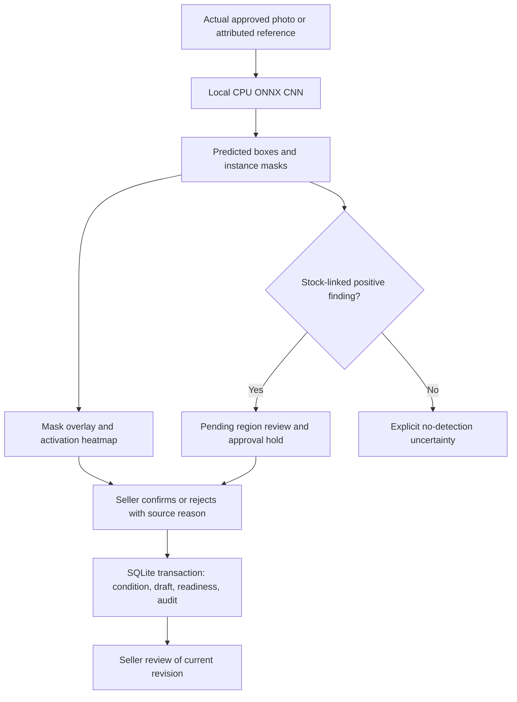
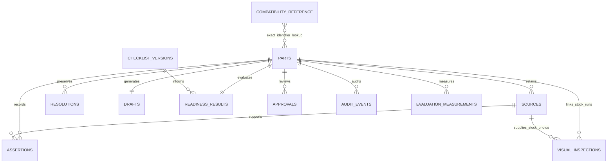
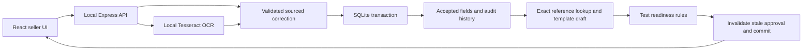
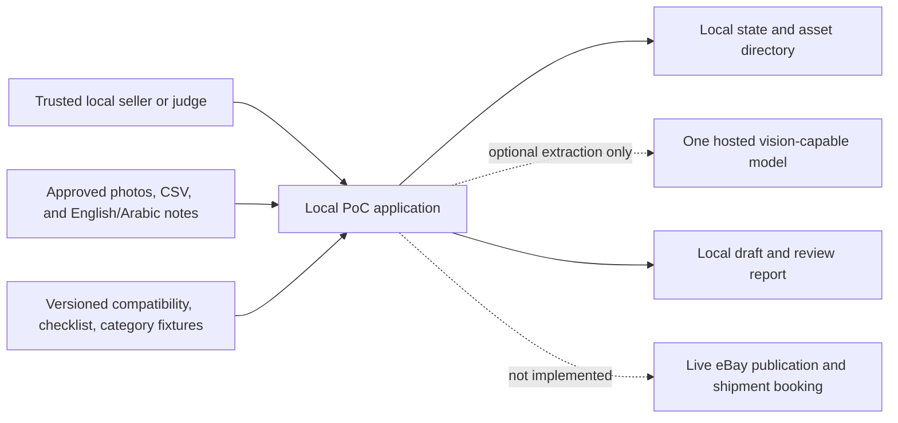
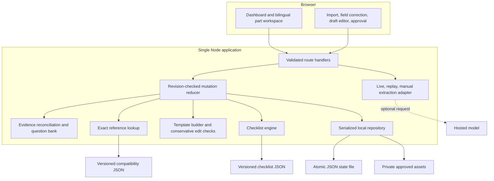
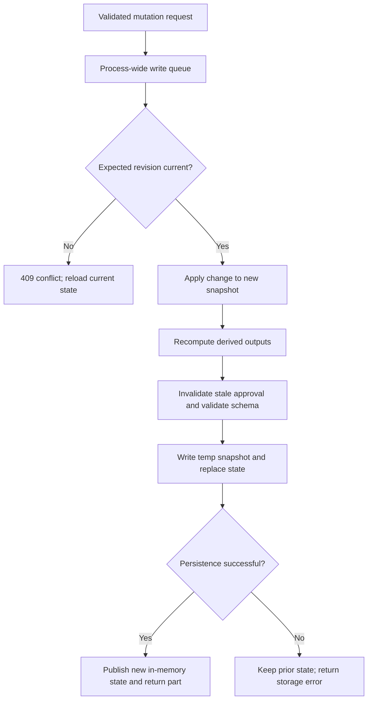
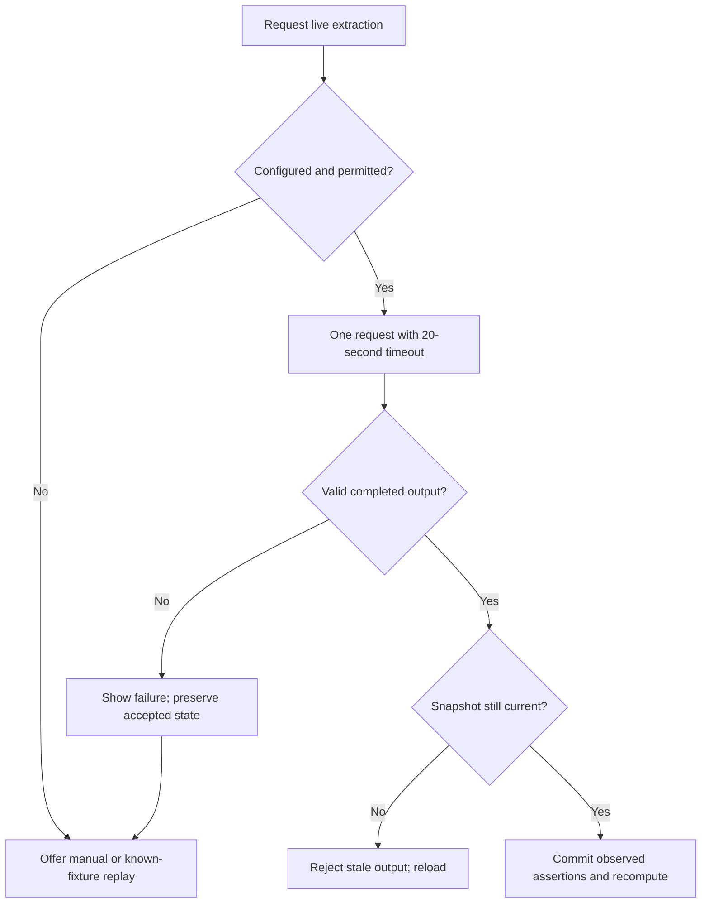
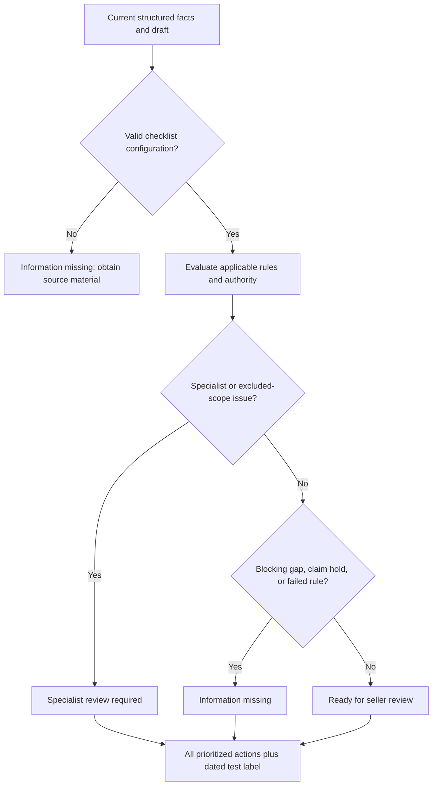
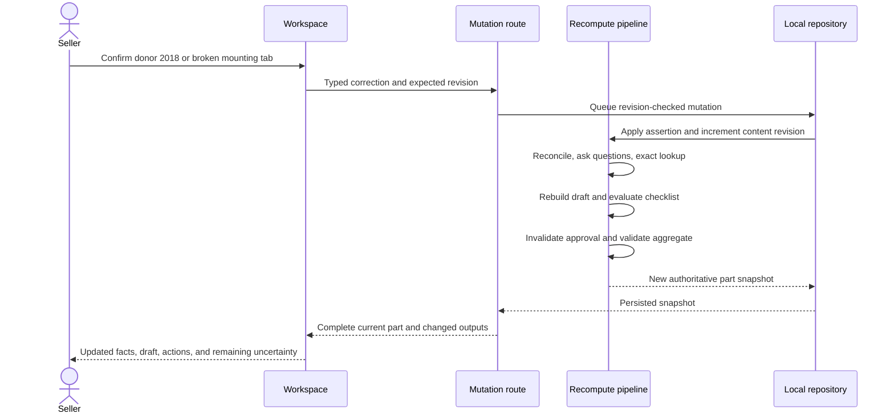

# TRD — Technical Requirements Document

## Lightweight implementation contract for the eBay salvage-parts PoC

| Item | Decision |
|---|---|
| Version/date | 1.2 — 27 October 2026 |
| Status | React/Express/SQLite, local OCR and CPU CNN segmentation plus identity, buyer, UAE/UK trade-lane, compliance and review-required translation workflows implemented; build, 21 regression tests, five browser journeys and Docker inference validated |
| Business/product contracts | [BRD](BRD.md), [PRD](PRD.md) |
| Source/research | [Full requirements and research brief](EBAY_HACKATHON_REQUIREMENTS_AND_RESEARCH.md) |
| Primary deployment | Local Windows laptop, one trusted operator, one Node process |
| Runtime observed | Node `v24.14.1`, npm `11.11.0`; Python `3.11.9` exists but is not needed by this design |
| Data volume | Twenty active sample records; ten selected demo mirrors |
| Core architecture | React/Vite frontend, Express backend, Node 24 SQLite database; deterministic domain modules |
| AI strategy | Offline Tesseract OCR plus pretrained damage-segmentation CNN exported to CPU ONNX; manual sourced confirmation |

> **Authoritative offline implementation update:** `frontend/` contains React/Vite; `backend/` contains Express, domain rules and Node's built-in SQLite driver. `.local-data/yardpass.sqlite` is the real transactional database. Tesseract.js performs CPU OCR from bundled `models/tessdata/` files; no external application API, CDN, remote font or runtime model download is permitted. Prior Next.js, JSON-store and hosted-extractor sections below are retained as historical proposals and superseded by the implementation contract here and the source code.

### Database and deployment contract

- SQLite schema in `backend/schema.sql`: `parts`, `sources`, `assertions`, `resolutions`, `drafts`, `readiness_results`, `approvals`, `audit_events`, `compatibility_reference`, `checklist_versions`, `evaluation_measurements`, `schema_migrations`, `visual_inspections`.
- Foreign keys, unique stock IDs, parameterized statements, WAL mode and `BEGIN IMMEDIATE` transactions preserve consistency.
- Corrections supersede active assertions while retaining history, increment the record revision, recompute draft/readiness and invalidate approval in the same transaction.
- Images are private files referenced by source IDs; generated dataset assets are clearly synthetic OCR labels, not photographs of real parts.
- One Docker application container serves compiled frontend plus local APIs; a named volume persists SQLite and uploads. No separate DB server/GPU/container stack is needed.
- **Primary audience: B2B salvage seller operators.** Downstream buyers can be explicit B2B garages/traders or inferred B2C vehicle owners. No consumer portal or multi-tenant/authentication platform is introduced.
- Setup downloads packages/models once; runtime is local-only. OCR timeout is 30 seconds; visual response budget is 60 seconds. Arbitrary translation and dedicated detached-mirror fault accuracy are not claimed.

### Local visual model contract (implemented)

- `backend/vision.mjs` uses CPU ONNX Runtime with the 640px exported YOLO26m damage-segmentation model in `models/vision/damage.onnx`; no Python service, GPU, training or hosted inference at runtime.
- Letterbox RGB input, run the actual graph, decode six class scores plus 32 prototype-mask coefficients, apply class-aware NMS, crop/unpad masks back to source dimensions, and produce PNG overlays.
- Heatmap equals segmentation activation multiplied by detection score; it is not Grad-CAM, calibrated certainty, structural safety or defect severity. Dataset mirror-part masks are displayed separately as original annotations, not predictions.
- `datasets/vision/images.json` retains 12 actual mirror crops and four plate-redacted vehicle benchmark derivatives, source IDs, geometry, hashes, attribution, modifications and license caveats. Whole-vehicle examples do not become mirror stock.
- New SQLite table `visual_inspections`: source/part/example IDs, revision/hash, model result, per-region review and original/overlay/heatmap artifact paths. Files remain private and are served through mapped IDs.
- Standalone endpoints: `GET /api/vision/config`, example image/annotation retrieval, `POST /api/vision/examples/{id}/inspect`, `POST /api/vision/upload`, safe result-artifact retrieval and mirror-only reference-record creation.
- Stock endpoints: `POST /api/parts/{id}/vision` and `POST /api/parts/{id}/vision/{inspectionId}/review`, with expected revision, source membership/hash validation and explicit confirmation/rejection reason.
- Positive predictions remain pending, block approval and add cautious disclosure. Seller confirmation adds a condition assertion, recomputes draft/readiness and invalidates prior approval in one transaction. Rejection remains audited; repeated unresolved inspection is refused.
- ONNX source and exported hashes, exact class mapping and source/derivative license notices are retained. Python is export-only and excluded from Docker; optional CUDA downloads are disabled.
- `scripts/validate-vision.mjs` smoke-tests all 59 referenced images and saves observations to `evaluation/vision-smoke-results.json`. It does not establish precision/recall or held-out generalization because independently labelled damage truth is absent.
- Observed native run: 549–992 ms per image; all 12 mirror crops produced no detections at 0.35, while three Kia images produced 1/3/1 suggestions. Those zero results do not establish clean condition. Docker positive example ran in 1,358 ms; this is one observation, not a latency guarantee.



### Implemented database relationship diagram



### Implemented request flow



- Actual schema: `backend/schema.sql`; persistence: `backend/database.mjs`; routes: `backend/server.mjs`; business engine: `backend/domain.mjs`; OCR: `backend/ocr.mjs`.
- Runnable setup, endpoints and limitations are documented in `README.md`. The two diagrams above describe the current build; reference lookup relationships are application-level, not SQL foreign keys.

## 1. Original architectural decisions (historical proposal)

| ADR | Decision | Benefit / trade-off |
|---|---|---|
| ADR01 | Next.js with TypeScript and Node-runtime route handlers | UI and backend in one repository/runtime; no cross-service CORS or Python setup |
| ADR02 | Tailwind or simple project CSS, using the team’s familiar component patterns | Attractive interface without adding a complex UI framework migration |
| ADR03 | Zod runtime validation | One explicit contract for API, persisted data, and extracted values |
| ADR04 | Papa Parse for CSV; XLSX deferred | Preserves strings and avoids spreadsheet/office parsing complexity in P0 |
| ADR05 | Local JSON state behind one repository interface | No database service/native build/ORM migration for twenty records; single-process limit |
| ADR06 | Versioned JSON compatibility/checklist/category fixtures | Inspectable exact lookup and rules; no API credentials or vector search |
| ADR07 | Deterministic draft templates | Fast, reproducible disclosure-preserving output; advanced prose is P1 |
| ADR08 | One optional hosted extractor with direct server-side HTTP | No local GPU/model-serving dependency; model capability/access must be verified |
| ADR09 | Replay recognizes exact source bundles; manual fallback for other inputs | Reproduction without invented extraction; replay quality is not live-model quality |
| ADR10 | One mutation reducer recomputes all derived outputs | Correct-once behavior and approval invalidation are centralized |
| ADR11 | Synchronous extraction request with 20-second timeout | No queue, worker, streaming, or poller in P0; explicit fallback after failure |
| ADR12 | Local loopback deployment only | Honest boundary for unauthenticated single-operator storage and file access |

- Package choices are proposed. Select mutually compatible stable releases, verify Node `v24.14.1`, and pin exact versions in the generated lockfile during implementation.
- No claim is made that a particular Next.js/React/package version has already been installed or validated.
- Use familiar React patterns; no custom global state library is required. A part workspace can hold server state in a component and refetch after mutations.

## 2. System context and components

### 2.1 Context diagram



### 2.2 Internal architecture



### 2.3 Planned module boundaries

| Module/file | Responsibility |
|---|---|
| `src/app/page.tsx` | Batch dashboard |
| `src/app/parts/[id]/page.tsx` | Part workspace route |
| `src/components/ImportPanel.tsx` | CSV/photo/note import and preview |
| `src/components/EvidencePanel.tsx` | Source and conflicting-assertion display |
| `src/components/FieldEditor.tsx` | Localized confirmations and corrections |
| `src/components/QuestionQueue.tsx` | Prioritized fixed question bank |
| `src/components/DraftEditor.tsx` | Editable draft and protected disclosure sections |
| `src/components/ReadinessPanel.tsx` | Rule statuses, source versions, and actions |
| `src/components/ApprovalPanel.tsx` | Current-revision approval and preview |
| `src/app/api/` | Route handlers described in Section 5 |
| `src/lib/contracts.ts` | Schemas, enums, and API response contracts |
| `src/lib/repository.ts` | Single-process load, revision checking, serialized writes |
| `src/lib/mutations.ts` | Central content-update reducer and recomputation |
| `src/lib/importCsv.ts` | CSV parsing, mapping, preview, and source locators |
| `src/lib/evidence.ts` | Assertions, accepted values, explicit conflict resolution |
| `src/lib/questions.ts` | Fixed English/Arabic questions and applicability |
| `src/lib/compatibility.ts` | Exact lookup and unresolved constraints |
| `src/lib/drafts.ts` | Canonical template generation and permitted variants |
| `src/lib/claimChecks.ts` | Protected-section checks and unvalidated-edit holds |
| `src/lib/readiness.ts` | Rule evaluator and status precedence |
| `src/lib/approval.ts` | Content digest and approval eligibility |
| `src/lib/extraction.ts` | Adapter interface and mode dispatch |
| `src/lib/liveExtractor.ts` | One provider request, timeout, response validation |
| `src/lib/replayExtractor.ts` | Exact fixture mapping and citation remapping |
| `src/lib/i18n.ts` | Fixed English/Arabic labels |
| `fixtures/parts.json` | Fictional sample records and source manifest |
| `fixtures/extractions.json` | Labelled replay assertions, not the judge answer key |
| `fixtures/compatibility.json` | Approved or unmistakably synthetic lookup entries |
| `fixtures/checklist.json` | Dated/versioned supplied or demo-only rules |
| `fixtures/categories.json` | Advisory category/aspect fixtures |
| `fixtures/assets/` | Owned/approved/individually licensed sample images |
| `evaluation/answer-key.json` | Evaluation-only truth; never imported by app/server/model |
| `tests/domain.test.ts` | Pure-function regression tests |
| `tests/api.test.ts` | API/revision/persistence tests |
| `tests/journeys.spec.ts` | Critical browser journeys if browser automation fits the timebox |
| `.local-data/` | Runtime state, private assets, and recovery backup; ignored by Git |
| `package.json`, lockfile, `.env.example` | Reproducible dependency/runtime/configuration setup |

- This table specifies planned files, not files created by this documentation task.
- Avoid a separate backend, ORM, message broker, or external object-store integration.

## 3. Data contracts

### 3.1 Identity and enums

- `partId`: server-generated opaque ID; never a guessed manufacturer number.
- `stockId`: unique fictional seller stock reference within the batch.
- `contentRevision`: positive integer incremented on every source/assertion/field/draft-override/reference-context mutation.
- `storeRevision`: monotonically increasing global persistence revision; includes approval/audit writes.
- `sourceId`, `assertionId`, `runId`, and `eventId`: server-generated opaque identifiers.
- `evidenceState`: `unknown`, `observed`, `seller_confirmed`, `reference_supported`, `conflicting`.
- `testingStatus`: `unknown`, `untested`, `partial`, `reported_pass`, `reported_fail`.
- `side`: `left`, `right`, `unknown`; describes physical vehicle side, not camera orientation.
- `readinessStatus`: `ready_for_seller_review`, `information_missing`, `specialist_review_required`.
- `extractionMode`: `live`, `replay`, `manual`.
- `referenceAuthority`: `supplied_approved`, `demo_only`, `missing`.
- `ruleResult`: `pass`, `fail`, `unknown`, `not_applicable`.
- `approvalStatus`: `pending`, `approved`, `invalidated`.

### 3.2 Part aggregate

| Field | Type/content | Invariant |
|---|---|---|
| `partId`, `stockId` | Strings | Stable identity; stock ID unique |
| `family`, `corridor` | Fixed configured values | P0 is mirrors / test UAE-to-UK |
| `contentRevision` | Integer | Required expected revision on mutations |
| `scope` | In-scope/excluded plus reason | Excluded content cannot generate an approvable draft |
| `sources` | Source array | Assets and original row/note locators retained |
| `assertions` | Assertion array | Competing and rejected assertions retained |
| `fields` | Typed accepted fields | Each value has supporting assertion IDs/evidence state |
| `resolutions` | Explicit conflict-resolution array | Includes reviewer, reason, and covered competing assertion IDs |
| `defects` | Possible/confirmed observations with sources | Possible and confirmed remain distinct |
| `testing` | Status, functions, method/date if supplied, source IDs | “Reported pass” never means all possible functions certified |
| `packaging` | Dimensions/weight/units plus sources | Bare-part measurements kept separate |
| `hasDraft` | Boolean | Draft/checklist knows whether draft generation was requested |
| `draftOverrides` | Stored seller edits and selected variants | Unsupported edits are held, not silently adopted |
| `derived` | Conflicts, questions, compatibility, draft, claim checks, readiness | Recomputed from current content/context; includes `derivedFromRevision` |
| `referenceContext` | Checklist/category/fitment versions, digests, authority | Version changes invalidate stale content/approval |
| `approval` | Status, approved revision/digest/time | Never changes factual evidence |
| `audit` | Events for mutations, extraction, approval | Bounded local record; no secrets |

### 3.3 Accepted field structure

| Field | Type | Rule |
|---|---|---|
| `value` | Field-specific value or null | Null must be valid; no placeholder manufacturer/number/year |
| `state` | Evidence state | Machine proposals start observed, not seller confirmed |
| `assertionIds` | String array | Must exist in the same part and support the value |
| `updatedAt` | ISO timestamp | Audit metadata, not evidence of correctness |

- Fields include part type, manufacturer, identifier/type, donor make/model/year/variant, physical side, storage location, asking price/currency, and supplied feature/configuration data.
- Identifier and stock ID are strings. Disable dynamic numeric casting for CSV identifiers.
- Used condition is accepted from seller/source context; it is not inferred from an attractive photograph.
- Do not accept unsupported property keys into the schema.

### 3.4 Source and assertion structures

| Entity | Required content | Rules |
|---|---|---|
| Source | ID, type, logical role, content hash, original row/text or internal asset ID, language, approval label | Filename/path from upload is not used as filesystem authority |
| Locator | Source ID plus CSV row/column, note quote/span, or full image reference | Cropping coordinates optional P1 |
| Assertion | ID, field key, raw value, normalized candidate, locator, assertion kind, uncertainty, lifecycle | Preserve raw identifier text and ambiguous characters |
| Seller confirmation | Answer/correction, supporting source IDs, related assertion IDs, reason/timestamp | Recorded seller assertion, not independent certification |
| Resolution | Field key, chosen assertion/value, competing assertion IDs, reason | Later contradictory assertion reopens conflict |

- Assertion kind distinguishes spreadsheet/note extraction, image observation, seller assertion, and reference result.
- `rejected`/`superseded` are assertion lifecycle labels, not extra accepted-field evidence states.
- Unknown is absence of usable evidence, not an assertion with an invented value.

### 3.5 Derived compatibility contract

- `status`: `unverified`, `candidate_supported`, `constraint_missing`, or `explicit_mismatch`.
- `authority`: reference authority.
- `referenceId`, `version`, `digest`, `matchedRowIds`.
- Exact matched identifier/manufacturer plus satisfied and missing constraints.
- Candidate vehicle/configuration descriptions only from reference rows.
- `explicit_mismatch` requires explicit contradictory reference evidence; no search result cannot produce it.
- `demo_only` candidates render as synthetic demonstrations, never real compatible-vehicle claims.

### 3.6 Draft contract

- `generatedFromRevision`, `templateVersion`, `title`, `descriptionSections`, `categorySuggestion`, `itemSpecifics`.
- `descriptionSections`: overview, condition, testing, contents, donor provenance, compatibility/uncertainty.
- `protectedSectionIds`: mandatory used-condition/defect/testing/uncertainty sections.
- `variantId`: selected permitted wording/layout variant.
- `claimChecks`: errors/holds with affected section and action.
- Category suggestion includes fixture/source status; no unverified official marketplace ID is inserted.

### 3.7 Rule and readiness contract

| Rule attribute | Purpose |
|---|---|
| `ruleId`, `version`, `sourceDate`, `sourceRef` | Dated provenance |
| `authority` | Approved, demo-only, or missing |
| `appliesTo` | Family/corridor/configuration applicability |
| `operator` | Identifier of an implemented deterministic evaluator |
| `inputKeys` | Explicit required fields |
| `severity` | Specialist, blocking gap, or advisory |
| `questionKey`, `actionKey` | Fixed localized question/action |
| `result` | Pass/fail/unknown/not applicable |
| `evidenceIds` | Supporting source/assertion IDs |

- Do not execute arbitrary expressions or scripts from checklist JSON.
- Unknown operator/version is a configuration error; do not treat it as a pass.
- Suggested operators: `inScope`, `conflictsResolved`, `usedDisclosed`, `defectsDisclosed`, `testingDisclosed`, `includedContentsKnown`, `packagedMeasurementsKnown`, `compatibilityClaimsSupported`, `draftClaimsValidated`, `referenceAvailable`.
- Applicability/blocking behavior is configurable from the actual supplied checklist. Do not declare every missing identifier/untested part invalid by default.
- Draft approval is separate from checklist evaluation; avoid a circular “seller already approved” readiness rule.

## 4. Persistence and concurrency

### 4.1 Local repository design

- State file: `.local-data/state.json` containing schema version, store revision, parts, and audit summaries.
- Assets stored privately under server-generated IDs in `.local-data/assets/`.
- Only the repository module reads/writes state.
- Use a process-wide singleton mutation queue, including during development hot reload; do not create separate locks per route module.
- Read/validate startup state. Corrupt/unsupported schema causes a visible recovery error, not silent reseeding.
- Keep a last-known-good backup; restore only through an explicit confirmed local action.
- Write a validated full snapshot to a temporary file in the same directory, flush/close, and rename over the state file; keep prior state if replacement fails.
- Test replacement/recovery behavior on this Windows workspace. Do not claim crash-proof database guarantees.
- Default seeding occurs only if no state file exists; ordinary restart never resets seller changes.

### 4.2 Mutation transaction

1. Queue mutation.
2. Load current in-memory validated state and check expected `contentRevision`.
3. Apply content change without mutating the previous snapshot.
4. Increment part content revision if factual/source/draft/reference content changed.
5. Recompute derived outputs through the single pipeline.
6. Invalidate previous approval when content/digest changed.
7. Increment global store revision and append audit event.
8. Validate complete resulting state.
9. Persist new snapshot; publish it to in-memory state only after successful write.
10. Return authoritative complete part state.

- No HTTP/model call is held inside the persistence queue.
- External extraction captures a snapshot and commits only if the revision/source digest still matches afterward.
- Approval updates store revision but does not increment unchanged part content revision.
- Draft-generation action increments content revision only when `hasDraft` or selected content changes; repeated identical generation can return the current artifact without invalidating approval.
- Local multiple tabs are supported through optimistic conflicts, not independent stores.
- Multiple Node workers, horizontal replicas, serverless ephemeral filesystems, and shared-network state are unsupported.

### 4.3 Persistence flow



## 5. API contracts

### 5.1 Shared conventions

- JSON except upload endpoints; no production auth or publish/booking API.
- Part mutation requests include `expectedRevision`.
- Extraction/generation includes `requestId`; import uses `importId` for retry deduplication.
- Success envelope: `ok`, `data`, `requestId`.
- Error envelope: `ok=false`, `error.code`, `error.message`, optional field details/current revision, `requestId`.
- Return full authoritative part after a successful mutation to keep UI/draft/checklist synchronized.
- IDs and all bodies are schema validated; invalid paths or client-supplied filesystem locations are rejected.
- Check loopback origin/host for mutations and deny unintended cross-origin requests.

### 5.2 Endpoint inventory

| Method/path | Request | Success | Errors / behavior |
|---|---|---|---|
| `GET /api/config` | None | Family/corridor, limits, allowed/default modes, source versions, live-enabled flag | Never returns API key |
| `GET /api/health` | None | Runtime readiness, storage/config status | Unhealthy storage/config clearly identified |
| `GET /api/parts` | Optional status filter | Part summaries and counts | No hidden reseed |
| `GET /api/parts/{partId}` | Part ID | Complete part/evidence/derived/approval | 404 unknown part |
| `POST /api/import/csv` | Multipart CSV, `dryRun`, `importId` | Preview/errors when dry run; committed stock IDs when valid | 413 limit; 422 malformed/duplicate rows; 409 conflicting existing stock IDs |
| `POST /api/parts/{partId}/sources` | Multipart image or typed note, role, language, expected revision | Updated part and source IDs | 409 stale; 413 size; 415 unsupported type |
| `GET /api/assets/{assetId}` | Valid asset ID | Approved local source bytes with safe content type | 404 unknown ID; no arbitrary path access |
| `POST /api/parts/{partId}/extract` | Mode, source IDs, expected revision, request ID | Validated candidate assertions and recomputed part | 409 stale/run conflict; 422 invalid output; 503 unavailable mode; 504 timeout |
| `PATCH /api/parts/{partId}` | Expected revision; typed field corrections, question answers, conflict resolution, or draft overrides | Recomputed current part | 422 invalid values/evidence; 409 stale; unsupported overrides saved held when well-formed |
| `POST /api/parts/{partId}/draft` | Expected revision, permitted variant, request ID | Current generated draft plus readiness | No AI call in P0; excluded content blocked |
| `POST /api/parts/{partId}/approve` | Expected revision, expected digest, acknowledgments | Approval for current eligible draft | 409 stale; 422 unresolved blockers/held claims; repeated same approval idempotent |
| `GET /api/parts/{partId}/preview` | Part ID | Local read-only draft/report with source/test/mode labels | Not a published listing; no official platform payload promise |
| `POST /api/demo/reset` | Explicit confirmation and local-demo flag | Fresh seeded state | Disabled outside local demo; cannot run with active extraction/writes |

- API paths describe planned handlers, not available deployed endpoints.
- Import commit is all-or-nothing for a valid batch; fix invalid rows and resubmit rather than guessing skipped values.
- Existing stock IDs require explicit future update support; P0 rejects them instead of silently merging.
- Successful duplicate `importId` returns the original committed result; it does not import twice.
- P1 download/export can reuse preview data after the core path works.

### 5.3 HTTP errors

| Code | Meaning | UI action |
|---|---|---|
| 400 | Invalid request structure/path | Show field feedback |
| 404 | Part/asset missing | Return to dashboard or show missing source |
| 409 | Stale revision, duplicate run, or import conflict | Reload authoritative state; keep unsaved edits for review |
| 413 | Upload/note/record limit exceeded | Explain size/count limit |
| 415 | Unsupported file type | Explain JPEG/PNG/CSV/typed-note options |
| 422 | Domain/schema/claim/approval problem | Show issue and corrective action |
| 503 | Live mode/configuration unavailable | Offer explicit permitted replay/manual mode |
| 504 | Extraction timeout | Keep inventory; offer retry by user or explicit fallback |
| 500 | Unexpected persistence/internal error | Preserve old state, show request ID, no invented success |

## 6. Import and evidence-reconciliation flow

### 6.1 CSV contract

- Expected columns as defined in PRD F01; only nonempty unique `stock_id` is required to identify a row.
- `dynamicTyping=false`; convert only schema-validated numeric fields deliberately.
- Preserve raw row, row number, original column, and content hash.
- Asking price without currency remains incomplete; no assumed AED/GBP.
- Year must be a plausible explicitly provided year, but acceptance does not prove donor identity.
- Unknown columns are retained as original source context, not accepted as executable instructions or arbitrary schema fields.
- Reject duplicate headers/ambiguous mappings unless the operator resolves the mapping.
- Formulas remain strings; do not execute them. Sanitize formula-like strings on any future spreadsheet export.

### 6.2 Images and typed notes

- Validate signature/MIME for JPEG/PNG, size, count, and target stock ID.
- Generate internal asset IDs; preserve original names only as escaped display metadata.
- P0 source locators can point to a full image; never manufacture precise boxes.
- Retain original Arabic text; store translations as separate proposed assertions.
- Notes are rendered as escaped text, not HTML.
- Demo assets should be reasonably sized before the event; in-app image resize/crop is P1 if it becomes a distraction.

### 6.3 Reconciliation rules

- Group assertions by field and compare normalized candidates while preserving raw forms.
- Conflicting supported candidates remain unresolved until an explicit resolution identifies the competing assertions and chosen value.
- Mere timestamp order, confidence, or source type does not resolve a conflict.
- Seller correction creates a new attributable assertion and marks only explicitly rejected candidates as superseded/rejected.
- Previously resolved conflicts reopen when genuinely new contradictory evidence arrives.
- Critical extracted identifier/side/test/damage decisions request seller confirmation.
- Unknown test records remain `unknown`; explicit untested note produces `untested`.
- “Possible crack/tab damage” stays possible until confirmed or rejected.

### 6.4 Clarification engine

- Fixed bilingual question bank, not a new model call per question.
- Each question has key, field dependency, applicability, priority, source IDs, localized wording, and answer control type.
- Priorities: scope/specialist issue; conflict/claim-critical identity or condition; applicable package gaps; optional enrichment.
- Stable keys prevent duplicate questions after refresh.
- An “unknown” answer records the attempt and next action; do not loop on the same question without new evidence.

## 7. AI adapter, replay, and timeout design

### 7.1 Model choice and setup stop rule

- Use at most one small hosted model that the team verifies supports image inputs and the chosen structured-output schema.
- Configure the actual model ID at implementation; do not assume account access from a model name.
- No local Qwen weights, OCR framework, GPU, fine-tuning, embeddings, or agent orchestration in P0.
- Existing research model/tool candidates remain future alternatives, not installation prerequisites.
- Cap the initial hosted spike at two elapsed hours after manual/replay evidence flow works.
- If it fails, preserve the complete deterministic PoC and disclose live-model validation as incomplete.
- Optional live extraction is preferable for demonstrating genuine AI on permitted new inputs, but replay must remain available for judge reproduction.

### 7.2 Adapter input/output

| Input | Requirement |
|---|---|
| Part ID, expected revision, request ID | Snapshot/concurrency identity |
| Selected source IDs, roles, hashes | Only sources attached to this part |
| Raw CSV row and typed notes | Data-only context; capped lengths |
| Up to four permitted images | No unsupported MIME or unrelated assets |
| Fixed extraction schema/prompt version | Versioned and testable |

| Output | Requirement |
|---|---|
| Mode/model/prompt version and timing | Provenance, not an accuracy claim |
| Candidate field assertions | Field key, value/null, uncertainty, existing source references |
| Visible condition observations | Provisional; never functional proof |
| Raw identifier transcription | Ambiguity retained; no autocomplete |
| Refusal/invalid/incomplete result | Explicit failure, not fabricated fields |

### 7.3 Prompt/output safeguards

- Instruct extraction to return only visible/stated evidence, explicit nulls, and valid source IDs.
- Treat uploaded text as untrusted data and ignore embedded requests to alter application rules.
- Do not ask the model to infer vehicle ranges, certify authenticity, or determine electrical function from photos.
- Validate complete output schema, allowed fields, types, source membership, and citation spans where text is available.
- Image citations support a proposed observation and require review; schema validity does not prove the image assertion.
- Never let extraction set `seller_confirmed`, reference compatibility, readiness, or approval directly.
- Keep provider refusal, malformed output, missing output, timeout, and business uncertainty separate.

### 7.4 Replay design

- Each replay entry records fixture identity, logical source roles, per-source hashes, prompt version, and explicitly labelled recorded/synthetic candidate assertions.
- Match the exact part source bundle using canonical sorted roles/hashes, not filename or vehicle text.
- Map fixture logical source references to actual imported source IDs; reject missing/mismatched mapping.
- For CSV, hash the relevant canonical original row plus column mapping; retain the original file as source context.
- Different image bytes or note text are not a supported fixture match.
- Do not ship the judge answer key into the replay module.
- Replay assertions demonstrate software handling and may be intentionally incomplete/uncertain; they are not claimed live inference or a measured accuracy result.
- Unknown bundles return `REPLAY_FIXTURE_NOT_FOUND`; manual/live options remain explicit.

### 7.5 Extraction sequence and stale-result handling

```mermaid
sequenceDiagram
    actor Seller
    participant UI as Workspace
    participant API as Extraction route
    participant AI as Optional hosted extractor
    participant Repo as Repository queue
    Seller->>UI: Choose mode and extract current sources
    UI->>API: Part ID, revision, source IDs, request ID
    API->>API: Validate and capture source digest
    alt Replay exact bundle
        API->>API: Load labelled fixture and remap sources
    else Live enabled
        API->>AI: One structured extraction request
        AI-->>API: Output or refusal/error
    else Manual or unavailable bundle
        API-->>UI: Explicit manual/unavailable result
    end
    opt Valid completed candidate output exists
        API->>API: Validate candidate assertions
        API->>Repo: Commit only if revision and source digest unchanged
        alt Current
            Repo-->>API: Recomputed authoritative part
            API-->>UI: Updated current part
        else Seller changed content meanwhile
            Repo-->>API: Stale snapshot; candidates not committed
            API-->>UI: 409 conflict; reload current part
        end
    end
```

### 7.6 Timeout and retry

- Use a 20-second request timeout via server-side abort; disable automatic SDK retries or use direct HTTP.
- No automatic retry in P0; seller-triggered retry has a new request ID and remains bounded.
- Prevent concurrent extraction on the same part; return conflict or current run status without issuing duplicate billed calls.
- Process restart clears in-memory running state; a previously active run is not automatically resumed.
- Failure does not mutate accepted facts or silently switch modes.
- Explicit known-fixture replay/manual fallback is visible in results and evaluation.



## 8. Exact compatibility lookup

1. Require a usable confirmed identifier/type and manufacturer context where applicable.
2. Normalize only documented formatting; preserve ambiguous characters and suffixes.
3. Match exact identifier and reference namespace.
4. Check all constraints actually supplied by matching rows.
5. If a required side/configuration/connector is unknown, return `constraint_missing`.
6. If satisfied, return `candidate_supported` with exact row/version and authority.
7. No match returns `unverified`; explicit contradictory row can return `explicit_mismatch`.
8. Synthetic rows remain labelled `demo_only` in all outputs.

- No fuzzy match, embedding retrieval, donor-year extrapolation, or image similarity produces fitment.
- Fixed configuration fields not present in the reference are not secretly invented as constraints.
- Source-version changes trigger recomputation and approval invalidation.

## 9. Draft generation and editing contract

### 9.1 Canonical templates

- Generate directly from accepted facts and selected permitted wording variant.
- Title uses supported manufacturer/part/side/configuration terms; do not imply donor year is fitment.
- Description includes used condition, known/suspected defects, testing status/limits, included contents, donor provenance, and fitment uncertainty.
- Item specifics map accepted field keys to advisory category fixture labels.
- Canonical disclosures remain present even when there are no supported compatibility candidates.
- Template generation is local and deterministic; no model call is needed.

### 9.2 Edit validation — deliberate PoC restriction

- Title and description are visibly editable. Seller text changes are stored, previewed, and validated separately from canonical facts.
- Underlying factual edits use inventory controls and evidence links; they trigger complete regeneration.
- P0 auto-approval accepts canonical evidence-backed template variants and harmless whitespace/case changes defined by the validator.
- Any other text override is conservatively `requires_claim_review`, even if it contains no flagged keyword.
- Keep protected factual/disclosure sections rendered from current structured evidence; a deletion attempt is rejected/restored and held.
- Clear an override hold only by restoring canonical text, selecting a permitted variant, or updating supported structured facts and regenerating. There is no “trust this sentence” blanket override.
- Keyword/new-number checks add explanations but are not the sole approval gate.
- Arbitrary free-form prose approval is P1/pilot work and needs additional reviewed claim mapping; the PoC does not pretend to solve universal natural-language fact verification.
- This restriction preserves editable drafts while avoiding a fragile semantic-classifier dependency. Disclose it in the demo/limitations.

### 9.3 Minimal claim checks

| Check | Action |
|---|---|
| Missing used-condition/required defect/testing/uncertainty section | Block/restore protected section |
| New part number/year range/feature without accepted source | Hold edit and show related field action |
| Guaranteed fitment, certified authenticity, photo-derived full function, clearance claim | Block and explain trust boundary |
| Changed donor content treated as compatibility | Block and regenerate separated sections |
| Noncanonical free-form override | Hold until canonical/evidence-driven resolution |
| Old generated revision or source/context digest | Regenerate and invalidate approval |

## 10. Readiness engine

### 10.1 Deterministic procedure

1. Load/validate configured rules and authority/version.
2. Evaluate scope and applicable field/disclosure/claim rules.
3. Produce pass/fail/unknown/not-applicable with source references.
4. Retain all issues/actions and sort by configured severity/priority.
5. Choose primary status: specialist/excluded first; then blocking unknown/fail; otherwise ready for seller review.
6. Include `testOnly=true` and reference-authority label in all results.

- Missing approved material cannot be replaced by AI memory.
- With an explicit demo-only fallback, statuses are provisional test outcomes, not official conclusions.
- If required configuration is missing entirely, return information missing and the dependency action.
- Untested parts/missing identifiers may remain reviewable where the actual supplied rules permit proper disclosure.

### 10.2 Readiness flow



## 11. Correct-once recomputation and approval

### 11.1 Recompute order

- Validate content mutation.
- Reconcile accepted fields/assertions and explicit resolutions.
- Rebuild missing/conflict questions.
- Perform exact reference lookup.
- Generate canonical draft if `hasDraft=true`.
- Revalidate text overrides and protected sections.
- Evaluate readiness.
- Compute stable content digest.
- Invalidate approval if revision/context/digest changed.
- Persist together as one aggregate.

### 11.2 Approval digest and conditions

- Digest uses canonical serialization of current accepted facts, relevant assertions/sources, reference/template versions, actual draft text/validated variant, rule outcomes, and content revision.
- Exclude volatile request IDs, last-view times, and approval timestamp from the digest.
- Check: in scope, current generated draft, no claim holds/blocking issues, required ready status, matching expected revision/digest, required seller acknowledgments.
- Store approved revision/digest/time and `approvalStatus=approved` without changing the approved content revision.
- Repeat approval for identical revision/digest returns same result; it does not create new factual evidence.
- Any later source/field/draft/reference-context change increments content revision and invalidates approval.
- A newly supplied reference version is applied only through an explicit content-context update, not a silent file hot reload that leaves old approvals valid.

### 11.3 Correction sequence



## 12. Security, privacy, and operational boundaries

- Bind the demo to loopback, not a public unauthenticated deployment.
- Put hosted keys in server-only environment variables; never use `NEXT_PUBLIC_` for secrets.
- Proposed configuration: `DEMO_MODE`, `DEFAULT_EXTRACTION_MODE`, `AI_API_KEY`, `AI_MODEL`, `AI_TIMEOUT_MS=20000`, `DATA_DIR`; allowed mode flags returned without secrets.
- Use one fixed configured provider endpoint; clients cannot supply arbitrary remote fetch URLs.
- Permit only approved/synthetic files. Operator manually checks/redacts background faces, plates, location details, and unnecessary metadata before live upload; this is a disclosed process, not automatic anonymization.
- Validate source/asset IDs, content signatures, size/count, and target part ownership.
- Escape notes and draft text; never execute formulas/HTML/scripts or checklist code.
- Serve assets by mapped IDs, not user paths; runtime assets are not in a public static directory.
- Check mutation origin/host; no broad cross-origin access.
- Keep logs to request ID, part ID, revision, mode, status, latency, and usage when supplied. Do not log secrets, full images, or unnecessary raw personal content.
- Demo reset requires explicit confirmation, local flag, and no active operations.
- This PoC is not a public file-upload service, multi-user system, or comprehensive privacy/security solution.

## 13. Testing and performance budgets

### 13.1 Required automated domain tests

| Test | Contract |
|---|---|
| CSV identifiers | Preserve zeros, Arabic, row locators; reject malformed/duplicate rows |
| Source membership | Extracted citation cannot reference another part or missing source |
| Donor conflict | 2017/2018 unresolved until explicit resolution |
| Test statuses | Unknown, untested, partial, reported pass/fail do not collapse |
| Possible damage | Remains observation until confirmed; disclosure survives regeneration |
| Identifier matching | No fuzzy completion or no-match incompatibility |
| Reference constraints | Missing required variant prevents supported candidate |
| Arabic labels/negation | Reviewed fixture meaning and LTR identifier order retained |
| Question queue | Stable keys, applicable priority, unknown-answer behavior |
| Draft claims | Protected sections, noncanonical edit holds, unsupported guarantee blocking |
| Readiness | Three statuses, rule precedence, authority/date labeling |
| Correction propagation | All derived artifacts match content revision |
| Approval | Correct digest, stale conflict, material invalidation, idempotent repeat |
| Replay | Exact bundle mapping; unknown input rejected; no judge key imported |
| Persistence | Restart retains state; failed write keeps prior snapshot |

### 13.2 API/browser tests

- Stale PATCH and stale extraction commit return 409 without data loss.
- Live mode disabled/timeout/invalid response is explicit; no silent replay.
- Oversized/wrong-type upload rejected; asset path traversal impossible through IDs.
- Duplicate import/run IDs do not create duplicate stock or billed calls.
- Normal fixture completes to explicit local approval.
- PDF difficult fixture exposes all stated issues and leaves unresolved fitment visible after partial correction.
- Unsupported free-form edit stays held until canonical/evidence-driven resolution.
- Approved part changed in another tab cannot be approved from a stale tab.
- Excluded input cannot generate approvable draft.
- Mermaid documentation is descriptive; it does not replace actual API/domain tests.

### 13.3 Proposed budgets, not measured promises

| Operation | Target |
|---|---|
| Dashboard / local read | Under 1 second for twenty records on demo machine |
| Save + all deterministic recomputation | Under 1 second for twenty-record state |
| Template generation / exact lookup | Local operation; no model round trip |
| Optional extraction | One request, 20-second hard timeout, no automatic retry |
| Hosted integration spike | Two elapsed hours maximum after deterministic slice works |
| Final hardening/evaluation | Reserve approximately final quarter of team effort |

- Measure actual timings and identify whether OneDrive file synchronization affects local write behavior.
- If OneDrive causes observed persistence interference, document an approved local working-copy deployment choice before moving anything; do not silently relocate user files.
- No multi-worker stress test or 120-part scalability claim is required for the ten-part demo.

### 13.4 Manual business evaluation

- Use an evaluator-owned key outside application imports.
- Compare same source inventory under manual and assisted conditions.
- Capture preparation time, supported-attribute accuracy, missing/conflict precision/recall, disclosure completeness, and factual corrections.
- Report mode/model/sample size and actual failures.
- Replay evaluations demonstrate workflow/rules, not generalization of live model extraction.
- Do not include canned success percentages in the UI or short note.

## 14. Implementation sequence and stop rules

### Day 1 — deterministic vertical slice

1. Scaffold one app on the observed Node runtime and pin compatible dependencies.
2. Define contracts, fictional fixtures, source manifest, authority labels, and local repository.
3. Implement read/import/source/patch APIs and dashboard/evidence fields.
4. Implement assertions, conflicts, fixed English/Arabic questions, and manual/replay extraction.
5. Persist/restart one corrected part successfully.
6. Only now attempt the optional hosted adapter; stop after two hours if not useful.

### Day 2 — complete review workflow

1. Exact compatibility lookup and pending/unverified behavior.
2. Canonical draft generator and conservative editor holds.
3. Checklist engine and prioritized actions.
4. Shared recomputation pipeline, current-revision responses, approval digest/invalidation.
5. Normal and PDF difficult path end to end.
6. Refine readable bilingual workspace without adding new infrastructure.

### Day 3 — acceptance, evaluation, and delivery

1. Domain/API critical tests and persisted-state recovery.
2. Manual-versus-assisted measurement with independent key.
3. Clean default replay/manual setup and live limitations recorded.
4. Fix only release-blocking correctness issues.
5. Short supporting note and exactly five-minute normal/difficult rehearsal.

### First features to cut

- XLSX, crop highlighting, AI prose, advanced charts, voice, and downloads.
- Do not cut CSV/photos/notes, provenance, conflict handling, exact fitment limits, disclosures, propagation, approval, baseline measurement, or honest mode labeling.
- Do not substitute a fabricated API/model result for an unfinished integration.

## 15. Setup and demonstration runbook requirements

- Include the tested Node version, exact dependency lockfile, environment template, and install/build/start instructions when implementing.
- Default configuration starts replay/manual without a hosted key.
- Boot validates state/schema/fixtures and seeds only a genuinely absent store.
- Dataset and checklist show approved vs demo-only authority.
- Select ten demo parts from the twenty-record pack; do not accidentally demo all categories.
- Provide confirmed local reset and two documented journeys.
- Verify browser refresh/restart preserves corrections and approval state.
- Keep host loopback; no serverless/cloud credentials/deployment required.
- Deliver source/setup/short note/actual results/five-minute demo, not only screenshots.
- This documentation task has created only BRD/PRD/TRD, not an executable application or run commands.

## 16. Technical-to-product traceability

| Technical requirement | Implementation owner/module | Product/business mapping |
|---|---|---|
| T01 — Validated CSV/photo/note association | Import/routes/repository | F01 / B01 |
| T02 — Sourced assertions and accepted fields | Contracts/evidence | F02 / B01 |
| T03 — Explicit conflict resolution | Evidence/mutations | F03 / B02 |
| T04 — Fixed Arabic/English UI/question bank | i18n/components/questions | F04 / B03 |
| T05 — Applicable prioritized questions | Questions/readiness | F05 / B02 |
| T06 — Exact versioned compatibility lookup | Compatibility/fixtures | F06 / B04 |
| T07 — Deterministic editable draft/category/aspects | Drafts/editor/category fixtures | F07 / B05 |
| T08 — Protected sections and conservative override holds | Claim checks/editor | F08 / B05, B08 |
| T09 — Dated rule-driven three-state readiness | Readiness/checklist | F09 / B06 |
| T10 — Revisioned atomic recomputation | Mutations/repository | F10 / B07 |
| T11 — Content digest and seller approval | Approval/routes | F11 / B08 |
| T12 — Explicit bounded live/replay/manual adapter | Extraction adapters | F12 / B09, B11 |
| T13 — Local privacy/file/scope controls | Routes/config/validation | F13 / B08, B09 |
| T14 — Independent measurement and event records | Evaluation/audit/tests | F14 / B10 |
| T15 — Single-runtime reproducible delivery | Package/config/runbook/tests | F15 / B11, B12 |

## 17. Future pilot architecture — not a PoC prerequisite

- Replace repository implementation with a transactional database when multi-user/persistent hosted deployment is required.
- Add authentication, authorization, per-seller isolation, secure storage, retention/deletion, and stronger operational monitoring.
- Obtain licensed maintained fitment/category/checklist data and authorized platform access.
- Evaluate true image/Arabic extraction on representative unseen sources.
- Add reviewed claim mapping for arbitrary edited prose if needed.
- Add durable background jobs only when extraction traffic and timeouts justify them.
- Keep the same evidence/revision/approval boundaries; advanced infrastructure must not weaken them.

## 18. Engineering definition of done

- [ ] One app runs on the documented runtime without Python/GPU/local model downloads.
- [ ] Replay/manual modes work without paid credentials; live behavior and limits are explicit.
- [ ] All P0 APIs and contracts are implemented with revision/schema validation.
- [ ] Sources and assertions remain inspectable and correctly associated.
- [ ] Exact reference lookup never guesses fitment.
- [ ] Draft disclosures are protected; arbitrary unvalidated prose is held.
- [ ] Dated test rules yield exactly the three required readiness statuses.
- [ ] Correct-once changes persist atomically and propagate to every derived artifact.
- [ ] Late responses and stale approvals cannot overwrite current content.
- [ ] Local security/data/license limitations are documented honestly.
- [ ] Normal and PDF difficult journeys pass actual acceptance checks.
- [ ] Manual comparison, setup instructions, supporting note, and five-minute demo are complete.

**Implementation rule:** Prefer the smallest component that satisfies the requirement, and prove the whole evidence-to-review journey before spending time on a heavier model or optional feature.
